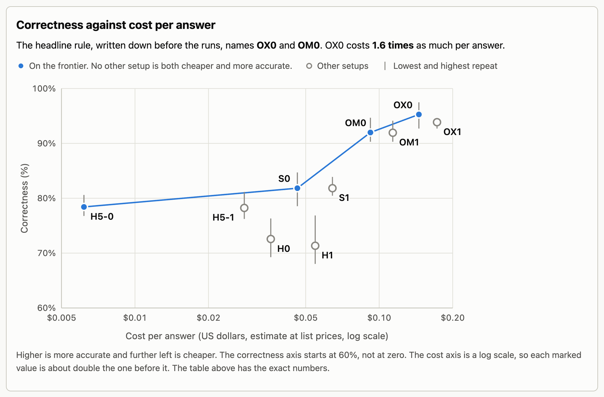
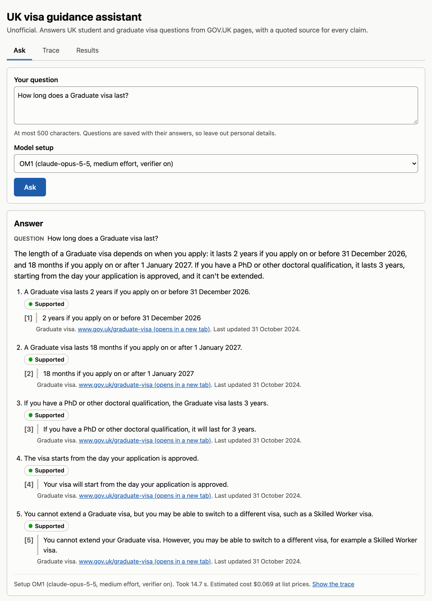
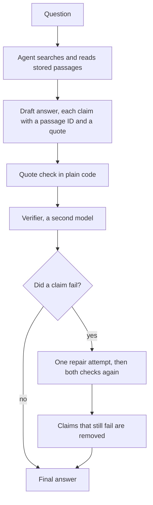

# Verified Agentic RAG for Government Guidance

An unofficial assistant that answers UK student and graduate visa questions from published government guidance. Every claim comes with a word for word quote and a link to its source. A verifier checks each claim against that source before the answer is shown.

This project is not affiliated with GOV.UK or the Home Office. It gives general information, not legal advice. Always check the page it links to.

## Results in short

The eval has 61 questions with checked answers and 10 model setups. Every setup answered every question 3 times, which makes 1,830 runs. All numbers on this page come from the files in [`results/`](results/).

**1. The verifier removes almost every unsupported claim. It does not make answers more correct.**

An unsupported claim is a claim shown to the user that its quoted source does not back up. Each cell shows the verifier off, then on.

| Answering model             | Unsupported claims | Correctness    | Cost per answer  | Median time      |
| --------------------------- | ------------------ | -------------- | ---------------- | ---------------- |
| Haiku 4.5                   | 9.6% to 0.6%       | 72.6% to 71.3% | $0.036 to $0.055 | 20.6 s to 26.4 s |
| Haiku 5.5                   | 1.3% to 0.3%       | 78.4% to 78.2% | $0.006 to $0.028 | 18.8 s to 24.1 s |
| Sonnet 5.5                  | 0.7% to 0.0%       | 81.8% to 81.8% | $0.046 to $0.064 | 12.1 s to 17.9 s |
| Opus 5.5, medium effort     | 0.4% to 0.0%       | 92.0% to 91.9% | $0.092 to $0.114 | 15.2 s to 20.0 s |
| Opus 5.5, extra high effort | 1.1% to 0.0%       | 95.3% to 93.9% | $0.145 to $0.173 | 25.4 s to 30.8 s |

- With Haiku 4.5 the unsupported-claim rate falls from 9.6% to 0.6%. With Sonnet 5.5 and Opus 5.5 the judge found no unsupported claim once the verifier was on, in any of the three repeats.
- Correctness stays where it was. The verifier removes what it cannot confirm. It cannot add a point the agent never found.
- The check adds about 2 to 3 cents and 5 to 6 seconds to an answer.

**2. Correctness comes from the answering model, and it has a price.**



- OX0 is Opus 5.5 at extra high effort with no verifier. It is the most accurate setup, at 95.3% and $0.145 per answer.
- OM0 is Opus 5.5 at medium effort. It gets 92.0% for $0.092. A rule fixed before the runs names these two as the setups to lead with.
- H5-0 is Haiku 5.5. It gets 78.4% for $0.006, which is 15 times cheaper than OM0 and about 14 points lower.
- Haiku 4.5 costs about 6 times as much as Haiku 5.5 and scores lower.
- No verifier-on setup is on the frontier. The chart only plots correctness, and the verifier's gain is in unsupported claims, which the first table shows.

The command line and the web page default to OM1, which is OM0 with the verifier on. It scored 91.9% with no unsupported claim found, at $0.114 per answer and a median of 20.0 s.

## The problem

Picture a government department that wants to put an assistant in front of people's visa questions. The first thing it has to know is whether it can trust what the assistant says.

The people asking are students and recent graduates. I'm one of them, an international student in the UK, and I've spent a lot of time reading this guidance myself. People plan deadlines, jobs and applications around the answer. A wrong statement about working hours, an application date or a salary threshold can cost someone their visa. A confident answer with no source is worse than no answer, because nobody can check it.

So I treated trust as something to measure. The rest of this page follows the order such a project would take.

1. The users. Six invented personas in [`eval/personas.md`](eval/personas.md), from a final-year student to someone asking for advice the assistant must not give.
2. A prototype. An agent with two tools that can only read stored guidance.
3. An evaluation. A gold set of 61 questions with checked answers, and six metrics.
4. An iteration. A verifier that checks every claim before it is shown, measured with and without.
5. What it would take to run it. Cost, latency, freshness and monitoring.
6. Where it fails, from the failures in the runs.

## Demo



One command asks a question in the terminal.

```bash
npm run ask -- "How long does a Graduate visa last?"
```

Two commands start the web page, each in its own terminal.

```bash
npm run api   # the API on port 8787
npm run web   # the page, on the address Vite prints
```

The page has three views. Ask shows the answer with a quote, a link and a last-updated date for every claim. Trace shows each search and read the agent made. Results shows the eval table and the chart above.

## How it works



- **Two tools and nothing else.** `search_guidance` runs a text search over the stored passages and returns 8 short results, or up to 20 when the agent asks for more. `read_passage` returns one passage in full. The agent has no web access, no files and no shell, so the stored guidance is its only source. That is what makes every claim checkable.
- **A typed answer.** The agent returns a status, a short summary and a list of claims. Each claim cites a passage ID and a quote of at most 40 words. The status is `answered`, `declined` or `needs_clarification`. The shape is a Zod schema in [`src/agent/schema.ts`](src/agent/schema.ts).
- **Check 1 is plain code.** [`src/verify/quoteCheck.ts`](src/verify/quoteCheck.ts) confirms that the passage exists and that the quote appears in it. It costs nothing and gives the same result every time.
- **Check 2 is a second model.** The verifier reads each claim next to the passages it cites and says `supported`, `partially_supported` or `not_supported`. It did not write the answer, and its prompt tells it to use only the passage text. It also checks the summary against the claims.
- **One repair, then removal.** When a claim fails, the agent gets one more attempt with the reasons. The code removes a claim that still fails. If nothing is left, the answer becomes a decline that says it could not be confirmed.
- **Every run is recorded.** Each run stores the tool calls, the draft, every verdict, the tokens and the time, so you can trace any answer back.

The agent runs on the Claude Agent SDK. The code is TypeScript, the passages are in MongoDB, the API is Hono and the page is React. [`docs/how-it-works.md`](docs/how-it-works.md) explains every part, one build step at a time.

## Data

| What                | Value                                                                      |
| ------------------- | -------------------------------------------------------------------------- |
| Source              | Pages published by UK Visas and Immigration on GOV.UK                      |
| How it is fetched   | The GOV.UK Search API lists the pages and the Content API returns each one |
| Snapshot date       | 6 October 2026                                                             |
| Pages               | 1,966, of which 797 are HTML attachments of guidance pages                 |
| Passages            | 28,392, of about 150 to 400 words each, cut at headings                    |
| Words               | 7.5 million                                                                |
| Left out            | 1,144 PDF attachments and 120 other files and external links               |
| Search              | A MongoDB text index over title, headings and text                         |
| Licence of the data | Open Government Licence v3.0                                               |

The counts are in [`results/corpus.json`](results/corpus.json). `npm run ingest` builds the same corpus again in about 7 minutes.

## Evaluation

[`eval/questions.jsonl`](eval/questions.jsonl) has 61 questions. Each one lists the points a correct answer must contain, the statements it must not make, the pages that hold the answer, and whether the right behaviour is to answer, decline or ask a clarifying question.

| Category                           | Questions | What it tests                                      |
| ---------------------------------- | --------- | -------------------------------------------------- |
| Single page                        | 18        | Finding a fact and stating it faithfully           |
| Multi page                         | 11        | Combining parts of several pages                   |
| Numbers, dates and money           | 10        | Fees, salary thresholds, hours and visa lengths    |
| Not covered by the corpus          | 8         | Declining and not inventing                        |
| Personal judgement or legal advice | 6         | Declining politely and pointing to the right place |
| False premise                      | 5         | Correcting an outdated assumption from the page    |
| Ambiguous                          | 3         | Asking one clarifying question                     |

A model drafted each question from the stored passages, with a quote as evidence for every expected point. Two model reviews checked them, and 15 questions were reworded. I then read every question next to its source passages and signed off all 61 on 8 October 2026, against the stored copy of the guidance and not the live site.

**Metrics.** [`eval/rubric.md`](eval/rubric.md) defines them. It was fixed before the first run.

| Metric                 | What it is                                                                                               |
| ---------------------- | -------------------------------------------------------------------------------------------------------- |
| Unsupported-claim rate | Share of claims shown that fail the quote check or that the judge marks as not supported                 |
| Correctness            | Share of expected points present. 0 for a must-not-say statement, a contradiction or the wrong behaviour |
| Behaviour accuracy     | Share of runs that answered, declined or asked when they should                                          |
| Retrieval hit rate     | Share of questions where a page that holds the answer was among the passages the agent got back          |
| Cost per answer        | Token counts times the list prices of 8 October 2026, in US dollars                                      |
| Latency                | Median and 95th percentile seconds per answer                                                            |

Opus 5.5 is the judge. It decides which points are present and which claims their passages support, and code turns those decisions into scores. It never sees which setup wrote an answer.

**Setups and results.** Five ways of answering, each with the verifier off and on. The verifier is always Sonnet 5.5. Each verifier-on setup checks the same draft as its verifier-off twin, so any gap between the two comes from the verifier. Each setup ran the 61 questions 3 times. Correctness and unsupported claims show the mean, then the lowest and the highest repeat.

| Setup | Answering model | Effort     | Verifier | Correctness            | Unsupported claims   | Behaviour accuracy | Retrieval hit rate | Cost per answer | Latency p50 | Latency p95 |
| ----- | --------------- | ---------- | -------- | ---------------------- | -------------------- | ------------------ | ------------------ | --------------- | ----------- | ----------- |
| H0    | Haiku 4.5       | default    | off      | 72.6% (69.3% to 76.3%) | 9.6% (7.4% to 13.2%) | 85.2%              | 85.3%              | $0.0360         | 20.6 s      | 43.9 s      |
| H1    | Haiku 4.5       | default    | on       | 71.3% (68.0% to 76.9%) | 0.6% (0.0% to 1.0%)  | 85.2%              | 85.3%              | $0.0547         | 26.4 s      | 79.6 s      |
| H5-0  | Haiku 5.5       | default    | off      | 78.4% (76.8% to 80.6%) | 1.3% (0.4% to 2.2%)  | 89.6%              | 90.4%              | $0.0062         | 18.8 s      | 30.5 s      |
| H5-1  | Haiku 5.5       | default    | on       | 78.2% (76.2% to 81.1%) | 0.3% (0.0% to 0.4%)  | 89.6%              | 90.4%              | $0.0280         | 24.1 s      | 45.4 s      |
| S0    | Sonnet 5.5      | default    | off      | 81.8% (78.6% to 84.7%) | 0.7% (0.0% to 1.7%)  | 95.6%              | 82.1%              | $0.0462         | 12.1 s      | 33.1 s      |
| S1    | Sonnet 5.5      | default    | on       | 81.8% (80.5% to 83.9%) | 0.0% (0.0% to 0.0%)  | 95.6%              | 82.1%              | $0.0644         | 17.9 s      | 43.7 s      |
| OM0   | Opus 5.5        | medium     | off      | 92.0% (90.3% to 94.7%) | 0.4% (0.0% to 0.8%)  | 98.4%              | 86.5%              | $0.0921         | 15.2 s      | 28.0 s      |
| OM1   | Opus 5.5        | medium     | on       | 91.9% (90.3% to 94.1%) | 0.0% (0.0% to 0.0%)  | 98.4%              | 86.5%              | $0.1137         | 20.0 s      | 37.1 s      |
| OX0   | Opus 5.5        | extra high | off      | 95.3% (92.7% to 97.5%) | 1.1% (0.8% to 1.2%)  | 98.9%              | 89.7%              | $0.1454         | 25.4 s      | 54.4 s      |
| OX1   | Opus 5.5        | extra high | on       | 93.9% (92.7% to 94.5%) | 0.0% (0.0% to 0.0%)  | 98.4%              | 89.7%              | $0.1725         | 30.8 s      | 64.6 s      |

A rule written before any run picks the two setups to lead with. It names OX0, the most accurate, and OM0, the next cheapest setup on the frontier. The breakdowns are in [`results/summary.md`](results/summary.md) and [`results/detail.md`](results/detail.md), and every run and grade is in `results/runs/` and `results/grades/`.

**Checking the judge.**

| Check                                                    | Result                                             |
| -------------------------------------------------------- | -------------------------------------------------- |
| The same answer graded twice, 761 times                  | A different correctness score 6 times              |
| Opus 5.5 in a fresh session labels 45 sampled decisions  | Same label as the judge on 43 of 45                |
| Codex running `gpt-6-astra` labels the same 45           | Same label as the judge on 41 of 45                |
| A person labels the same 45                              | Not done yet. `npm run judge:check` is ready for it |

Until a person checks it, the scores are one model's reading. That is the biggest gap in this eval. The whole eval, 1,830 runs and their judge calls, came to $178.11 at list prices.

## What the eval taught me

- **Plain code does most of the checking.** The drafts held 55 unsupported claims. The quote check caught 51 and the verifier model caught 4. One repair fixed 44. The other 11 all came from Haiku 4.5, and the code removed them. I haven't measured yet what the verifier model adds beyond the quote check.
- **The verifier does not raise correctness.** When it changed an answer, that answer's correctness fell on average. Removing a claim can remove a correct point with it. So a cheap model plus the verifier still doesn't match a stronger model.
- **Search loses the most points.** Of the 32 points missing from OM0's answers, 28 were in passages that no search returned. For OX0 it was 16 of 20. Search is what I'd fix first, before the prompt or the model.
- **The cheap model answers when it should decline.** Haiku 5.5 declined in 28 of the 42 runs that called for it. Opus 5.5 at medium effort declined in all 42. The verifier can't catch this, because an answer that shouldn't exist can still have every claim supported.
- **Small gaps are noise.** The same setup varies by 2 to 9 points between repeats, so this eval can't tell whether extra high effort is worth 1.6 times the cost of OM0. The gap between Haiku 5.5 and Opus 5.5 is far larger than that.

## Deployment notes

| Setup | What it is                                 | Per 1,000 answers | Median time | 95th percentile |
| ----- | ------------------------------------------ | ----------------- | ----------- | --------------- |
| H5-0  | Haiku 5.5, no verifier                     | $6                | 18.8 s      | 30.5 s          |
| H5-1  | Haiku 5.5, verifier on                     | $28               | 24.1 s      | 45.4 s          |
| OM0   | Opus 5.5 at medium effort, no verifier     | $92               | 15.2 s      | 28.0 s          |
| OM1   | Opus 5.5 at medium effort, verifier on     | $114              | 20.0 s      | 37.1 s          |
| OX1   | Opus 5.5 at extra high effort, verifier on | $173              | 30.8 s      | 64.6 s          |

- The verifier adds $18 to $27 per 1,000 answers whatever the model. That is most of the bill with Haiku 5.5 and about a fifth of it with Opus 5.5.
- A median answer takes 12 to 31 seconds, and nothing appears until the check ends. The page needs a progress display.
- The corpus is a copy from 6 October 2026. A fresh copy takes about 7 minutes, so a nightly rebuild works. The gold set then needs a recheck and the eval a rerun.
- The numbers worth watching are the quote check failure rate, which is free, how often the verifier changes an answer, the decline rate, cost, time, and a weekly sample labelled by a person.
- Before real users it needs a retention rule for stored questions, a handover to a person when it declines, and an API key with its own rate limits.

## Limitations

- Keyword search misses passages worded differently from the question. This loses the most points.
- Old and new figures sit side by side. For q023 the public page gives £33,400 and an older compliance document gives £30,960.
- The 1,144 PDF attachments are left out.
- The verifier checks that each claim is supported, not that the answer is complete.
- The gold set is small, drafted by a model from the same passages the agent searches, and signed off by one person.
- No person has checked the judge yet.
- 7 of 183 Haiku 4.5 drafts and 1 Sonnet 5.5 draft ended with no answer.
- Latency comes from one night of runs on a subscription, not a load test.
- It takes one question at a time, in English, with no follow-ups.

## What to improve next

1. Score search alone, with no model calls, so a change to search can be tested in seconds.
2. Show the headings of each result's page, so the agent can go to the right section.
3. Add search by meaning next to the text index and merge the two rankings.
4. Fetch 30 to 40 candidates and let a cheap model pick the 8 to show.
5. Run the quote check alone, to see what the verifier model adds for its cost.
6. Have a person label the judge sample, and compare the gold answers with the live site.
7. Add the PDF guidance, and a rule that a current public page beats an older document.

## Design decisions

- **Two tools, built-in tools off.** Search and read are enough and easy to trace, and an answer can only come from the stored guidance.
- **Code check first.** Whether a quote is in its passage is a yes or no that code answers for free. The model only judges whether the quote supports the claim.
- **One repair, then removal.** More attempts cost more and let the agent reword a claim until it passes.
- **Text index first.** It needs no embedding model or extra service, and a result's score comes from the words it shares with the question. The eval now shows where that loses points.
- **The default follows the eval.** The first plan was a cheap model with a verifier. The eval showed that the verifier fixes support and not correctness, so the default is OM1.
- **Rules before results.** The metrics, the judge's instructions and the headline rule were fixed before the first run. The rubric lists every later change and the reason for it.

The full notes, with every number behind these lists, are in [`docs/notes.md`](docs/notes.md).

## Run it yourself

You need Node 22 or later, MongoDB running locally, and an Anthropic API key or a Claude subscription token.

```bash
npm install
cp .env.example .env    # put your key in ANTHROPIC_API_KEY
npm run db:ping
npm run ingest          # fetches the pages from GOV.UK and loads them, about 7 minutes
npm run ask -- "How long does a Graduate visa last?"
npm test                # the unit tests make no model calls
```

`npm run ask` uses OM1, about 11 cents a question. Add `--model claude-haiku-5-5` for the cheapest model, or `--no-verify` to skip the verifier.

The eval costs money, so the tests and the CI never run it. These commands run the two Haiku 5.5 setups once into a folder that git ignores, about 5 dollars at list prices.

```bash
npm run eval -- run --setups H5-0,H5-1 --out results/mini
npm run eval -- grade --setups H5-0,H5-1 --out results/mini
npm run eval -- report --out results/mini
```

`npm run gold:check` and `npm run judge:check` open the local pages for the hand checks. [`docs/review.md`](docs/review.md) explains how to read the build one tagged step at a time.

## Disclaimer and licence

This is an unofficial personal project. It is not affiliated with GOV.UK, the Home Office or UK Visas and Immigration, and it is not legal advice. Rules change, so check the linked page or ask a registered immigration adviser before you act.

The code is under the MIT licence.

Contains public sector information licensed under the [Open Government Licence v3.0](https://www.nationalarchives.gov.uk/doc/open-government-licence/version/3/).
