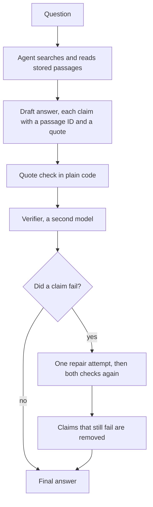

# UK visa guidance agent

An unofficial assistant that answers UK student and graduate visa questions from published government guidance. Every claim comes with a word for word quote and a link to its source. A verifier checks each claim against that source before the answer is shown.

This project is not affiliated with GOV.UK or the Home Office. It gives general information, not legal advice. Always check the page it links to.

## Results in short

The eval has 61 questions with checked answers and 10 model setups. Every setup answered every question 3 times, which makes 1,830 runs. All numbers on this page come from the files in [`results/`](results/).

**1. The verifier removes almost every unsupported claim. It does not make answers more correct.**

An unsupported claim is a claim shown to the user that its quoted source does not back up. Each cell shows the verifier off, then on.

| Answering model             | Unsupported claims | Correctness    | Cost per answer  | Median time      |
| --------------------------- | ------------------ | -------------- | ---------------- | ---------------- |
| Haiku 4.5                   | 9.6% to 0.6%       | 72.6% to 71.3% | $0.036 to $0.055 | 20.6 s to 26.4 s |
| Haiku 5.5                   | 1.3% to 0.3%       | 78.4% to 78.2% | $0.006 to $0.028 | 18.8 s to 24.1 s |
| Sonnet 5.5                  | 0.7% to 0.0%       | 81.8% to 81.8% | $0.046 to $0.064 | 12.1 s to 17.9 s |
| Opus 5.5, medium effort     | 0.4% to 0.0%       | 92.0% to 91.9% | $0.092 to $0.114 | 15.2 s to 20.0 s |
| Opus 5.5, extra high effort | 1.1% to 0.0%       | 95.3% to 93.9% | $0.145 to $0.173 | 25.4 s to 30.8 s |

- With Haiku 4.5 the unsupported-claim rate falls from 9.6% to 0.6%. With Sonnet 5.5 and Opus 5.5 the judge found no unsupported claim once the verifier was on, in any of the three repeats.
- Correctness stays where it was. The verifier removes what it cannot confirm. It cannot add a point the agent never found.
- The check adds about 2 to 3 cents and 5 to 6 seconds to an answer.

**2. Correctness comes from the answering model, and it has a price.**


- OX0 is Opus 5.5 at extra high effort with no verifier. It is the most accurate setup, at 95.3% and $0.145 per answer.
- OM0 is Opus 5.5 at medium effort. It gets 92.0% for $0.092. A rule fixed before the runs names these two as the setups to lead with.
- H5-0 is Haiku 5.5. It gets 78.4% for $0.006, which is 15 times cheaper than OM0 and about 14 points lower.
- Haiku 4.5 costs about 6 times as much as Haiku 5.5 and scores lower.
- No setup with the verifier is on the frontier, because the chart shows correctness. What the verifier buys is in the first table.

The default of the command line and the web page is OM1, which is OM0 with the verifier on. It scored 91.9% with no unsupported claim found, at $0.114 per answer and a median of 20.0 s.

## The problem

Picture a government department that wants to put an assistant in front of people's visa questions. The first thing it has to know is whether it can trust what the assistant says.

The people asking are students and recent graduates. They plan deadlines, jobs and applications around the answer. A wrong statement about working hours, an application date or a salary threshold can cost someone their visa. A confident answer with no source is worse than no answer, because nobody can check it.

So this project treats trust as something to measure. The rest of this page follows the order of such a project.

1. The users. Six invented personas in [`eval/personas.md`](eval/personas.md), from a final-year student to someone asking for advice the assistant must not give.
2. A prototype. An agent with two tools that can only read stored guidance.
3. An evaluation. A gold set of 61 questions with checked answers, and six metrics.
4. An iteration. A verifier that checks every claim before it is shown, measured with and without.
5. What it would take to run it. Cost, latency, freshness and monitoring.
6. Where it fails. Taken from the failures in the runs.

## Demo


One command asks a question in the terminal.

```bash
npm run ask -- "How long does a Graduate visa last?"
```

Two commands start the web page, each in its own terminal.

```bash
npm run api   # the API on port 8787
npm run web   # the page, on the address Vite prints
```

The page has three views. Ask shows the answer with a quote, a link and a last-updated date for every claim. Trace shows each search and read the agent made. Results shows the eval table and the chart above.

## How it works



- **Two tools and nothing else.** `search_guidance` runs a text search over the stored passages and returns 8 short results, or up to 20 when the agent asks for more. `read_passage` returns one passage in full. The agent has no web access, no files and no shell, so the stored guidance is its only source. That is what makes every claim checkable.
- **A typed answer.** The agent returns a status, a short summary and a list of claims. Each claim cites a passage ID and a quote of at most 40 words. The status is `answered`, `declined` or `needs_clarification`. The shape is a Zod schema in [`src/agent/schema.ts`](src/agent/schema.ts).
- **Check 1 is plain code.** [`src/verify/quoteCheck.ts`](src/verify/quoteCheck.ts) confirms that the passage exists and that the quote appears in it. It costs nothing and gives the same result every time.
- **Check 2 is a second model.** The verifier reads each claim next to the passages it cites and says `supported`, `partially_supported` or `not_supported`. It did not write the answer, and it is told to use nothing but the passage text. It also checks the summary against the claims.
- **One repair, then removal.** When a claim fails, the agent gets one more attempt with the reasons. A claim that still fails is removed. If nothing is left, the answer becomes a decline that says it could not be confirmed.
- **Every run is recorded.** The tool calls, the draft, each verdict, the tokens and the time are stored, so any answer can be traced back.

The agent runs on the Claude Agent SDK. The code is TypeScript, the passages are in MongoDB, the API is Hono and the page is React. [`docs/how-it-works.md`](docs/how-it-works.md) explains every part, one build step at a time.

## Data

| What                | Value                                                                      |
| ------------------- | -------------------------------------------------------------------------- |
| Source              | Pages published by UK Visas and Immigration on GOV.UK                      |
| How it is fetched   | The GOV.UK Search API lists the pages and the Content API returns each one |
| Snapshot date       | 6 October 2026                                                             |
| Pages               | 1,966, of which 797 are HTML attachments of guidance pages                 |
| Passages            | 28,392, of about 150 to 400 words each, cut at headings                    |
| Words               | 7.5 million                                                                |
| Left out            | 1,144 PDF attachments and 120 other files and external links               |
| Search              | A MongoDB text index over title, headings and text                         |
| Licence of the data | Open Government Licence v3.0                                               |

The counts are in [`results/corpus.json`](results/corpus.json). `npm run ingest` builds the same corpus again in about 7 minutes.

## Evaluation

**The gold set.** [`eval/questions.jsonl`](eval/questions.jsonl) has 61 questions. Each one has the points a correct answer must contain, statements it must not make, the pages that hold the answer, and whether the right behaviour is to answer, to decline or to ask a clarifying question.

| Category                           | Questions | What it tests                                      |
| ---------------------------------- | --------- | -------------------------------------------------- |
| Single page                        | 18        | Finding a fact and stating it faithfully           |
| Multi page                         | 11        | Combining parts of several pages                   |
| Numbers, dates and money           | 10        | Fees, salary thresholds, hours and visa lengths    |
| Not covered by the corpus          | 8         | Declining and not inventing                        |
| Personal judgement or legal advice | 6         | Declining politely and pointing to the right place |
| False premise                      | 5         | Correcting an outdated assumption from the page    |
| Ambiguous                          | 3         | Asking one clarifying question                     |

**How the gold answers were checked.** A model drafted each question from the stored passages, with a quote as evidence for every expected point. Two model reviews followed. One saw only the question and its passages, and the other could search the whole corpus. Every question either review flagged was settled against the stored pages, and 15 were reworded. The log is in [`eval/review-log.json`](eval/review-log.json). The owner then read the set on a local check page that shows each question, its expected points and the source passages side by side, and signed off all 61 on 8 October 2026. The answers were checked against the stored copy of the guidance, not against the live site.

**The metrics.** They are defined in [`eval/rubric.md`](eval/rubric.md), which was written before any run.

| Metric                 | What it is                                                                                               |
| ---------------------- | -------------------------------------------------------------------------------------------------------- |
| Unsupported-claim rate | Share of claims shown that fail the quote check or that the judge marks as not supported                 |
| Correctness            | Share of expected points present. 0 for a must-not-say statement, a contradiction or the wrong behaviour |
| Behaviour accuracy     | Share of runs that answered, declined or asked when they should                                          |
| Retrieval hit rate     | Share of questions where a page that holds the answer was among the passages the agent got back          |
| Cost per answer        | Token counts times the list prices of 8 October 2026, in US dollars                                      |
| Latency                | Median and 95th percentile seconds per answer                                                            |

A judge model, Opus 5.5, reads each answer and returns small decisions. It says which points are present and which claims their passages support. Code turns those decisions into scores. The judge never sees which setup wrote an answer.

**The setups.** Five ways of answering, each with the verifier off and on. The verifier is Sonnet 5.5 in every setup, so the setups differ only in the answering model. A verifier-on setup checks the same draft as its verifier-off twin. The gap between the two is then the verifier and nothing else.

**The results.** Each setup ran the 61 questions 3 times. Correctness and unsupported claims show the mean, then the lowest and the highest repeat.

| Setup | Answering model | Effort     | Verifier | Correctness            | Unsupported claims   | Behaviour accuracy | Retrieval hit rate | Cost per answer | Latency p50 | Latency p95 |
| ----- | --------------- | ---------- | -------- | ---------------------- | -------------------- | ------------------ | ------------------ | --------------- | ----------- | ----------- |
| H0    | Haiku 4.5       | default    | off      | 72.6% (69.3% to 76.3%) | 9.6% (7.4% to 13.2%) | 85.2%              | 85.3%              | $0.0360         | 20.6 s      | 43.9 s      |
| H1    | Haiku 4.5       | default    | on       | 71.3% (68.0% to 76.9%) | 0.6% (0.0% to 1.0%)  | 85.2%              | 85.3%              | $0.0547         | 26.4 s      | 79.6 s      |
| H5-0  | Haiku 5.5       | default    | off      | 78.4% (76.8% to 80.6%) | 1.3% (0.4% to 2.2%)  | 89.6%              | 90.4%              | $0.0062         | 18.8 s      | 30.5 s      |
| H5-1  | Haiku 5.5       | default    | on       | 78.2% (76.2% to 81.1%) | 0.3% (0.0% to 0.4%)  | 89.6%              | 90.4%              | $0.0280         | 24.1 s      | 45.4 s      |
| S0    | Sonnet 5.5      | default    | off      | 81.8% (78.6% to 84.7%) | 0.7% (0.0% to 1.7%)  | 95.6%              | 82.1%              | $0.0462         | 12.1 s      | 33.1 s      |
| S1    | Sonnet 5.5      | default    | on       | 81.8% (80.5% to 83.9%) | 0.0% (0.0% to 0.0%)  | 95.6%              | 82.1%              | $0.0644         | 17.9 s      | 43.7 s      |
| OM0   | Opus 5.5        | medium     | off      | 92.0% (90.3% to 94.7%) | 0.4% (0.0% to 0.8%)  | 98.4%              | 86.5%              | $0.0921         | 15.2 s      | 28.0 s      |
| OM1   | Opus 5.5        | medium     | on       | 91.9% (90.3% to 94.1%) | 0.0% (0.0% to 0.0%)  | 98.4%              | 86.5%              | $0.1137         | 20.0 s      | 37.1 s      |
| OX0   | Opus 5.5        | extra high | off      | 95.3% (92.7% to 97.5%) | 1.1% (0.8% to 1.2%)  | 98.9%              | 89.7%              | $0.1454         | 25.4 s      | 54.4 s      |
| OX1   | Opus 5.5        | extra high | on       | 93.9% (92.7% to 94.5%) | 0.0% (0.0% to 0.0%)  | 98.4%              | 89.7%              | $0.1725         | 30.8 s      | 64.6 s      |

The full table, with claims shown and runs that ended with no answer, is in [`results/summary.md`](results/summary.md). [`results/detail.md`](results/detail.md) breaks the same runs down by check, by category and by question. Every run and every grade is in `results/runs/` and `results/grades/`.

**The headline setups.** A rule written down before any run picks two setups to lead with. The most accurate setup is the one with the highest correctness. The cheapest accurate setup is the cheapest one within 2 points of it on correctness and within 1 point on unsupported claims. If one setup is both, the second is the next cheapest setup on the frontier. After the first pass the rule picked OX0 as the most accurate and OM0 as the cheapest accurate, and [`results/pass-1/`](results/pass-1/) keeps that report. With all three repeats OX0 is both, because OM0 is now 3.3 points behind, and the rule again names OM0 as the second. OX0 costs 1.6 times as much per answer as OM0.

**Checking the judge.** A judge that is a model can be wrong too, so it was checked in two ways. A third check, by a person, is set up and not done.

- The same answer graded twice. When the verifier changes nothing, a verifier-on setup shows the same final answer as its twin, and the judge grades both without knowing. That happened 761 times. The judge gave a different correctness score 6 times.
- Two other models against the judge. 45 of the judge's decisions, 30 claims and 15 answers, were drawn at random from the first pass. Two reviewers labelled them without seeing the judge's label. One was Opus 5.5 in a fresh session, which is the same model as the judge. The other was Codex running `gpt-6-astra` at extra high effort, which is a different model family. Opus 5.5 gave the same label as the judge on 43 of 45, and Codex on 41 of 45. All three agreed on 40. The five items they split on are close calls about the rules. Two are claims with a figure worked out from the passage and not printed in it. Three are answers where a point is stated only in part, or where an added exception may contradict a point. The table is in [`results/detail.md`](results/detail.md) and every label with its reason is in [`eval/judge-audit-reviews.json`](eval/judge-audit-reviews.json).
- A person against the judge. `npm run judge:check` shows the same 45 items one at a time without the judge's label. Nobody has labelled them yet. Until someone does, the correctness and unsupported-claim figures are one model's reading, checked by two other models and not by a person.

**What the whole eval cost.** The 1,830 runs and their judge calls come to $178.11 at list prices. A draft shared by a verifier-off setup and its twin is counted in both, so the real amount is lower. The runs were made with a subscription token, so the figure is the token counts priced at list prices and not an invoice.

## What the eval taught us

**The verifier works, and plain code does most of the work.** Across the five verifier-on setups, 55 claims in the drafts were not supported. The quote check caught 51 of them and the verifier model caught 4. Most unsupported claims were quotes that are not in the passage word for word, and Haiku 4.5 wrote 29 of the 51. One repair attempt was enough for Haiku 5.5, Sonnet 5.5 and Opus 5.5, where no claim still failed after it. With Haiku 4.5, 11 claims still failed and were removed.

**What the verifier model adds on top is not measured yet.** It caught 4 claims that the quote check let through. It judged 3 of them not supported and returned no verdict for the fourth, which counts as not supported by design. It also marked 45 to 57 claims per setup as partially supported and had 117 summaries rebuilt. The unsupported-claim rate counts neither, so this eval cannot say what they are worth. The next measurement is a run with the quote check alone.

**The verifier does not raise correctness, and its edits cost a little.** When it changed an answer, the correctness of that answer fell on average. It fell by 9.6 points over 27 answers for Opus 5.5 at extra high effort, and by 5.2 points over 59 answers for Haiku 4.5. A removed claim or a rebuilt summary can take a correct point with it. So a cheap model with the verifier does not match a stronger model. H5-1 scores 78.2% and OM0 scores 92.0%.

**Search loses more points than reading does.** The retrieval hit rate looks fine at 82% to 90%, but it only asks whether the right page showed up. `results/detail.md` asks the same about the passage. Of the 32 expected points missing from OM0's answers, 28 had a source passage that no search returned in that run. For OX0 it was 16 of 20, for Sonnet 5.5 it was 53 of 63 and for Haiku 5.5 it was 40 of 52. In question q028, about a healthcare surcharge paid twice, neither Opus setup got the page with the refund rules back in any of its 6 runs. With Opus 5.5 the agent almost never read the right passage and then missed the point, 0 times at medium effort and 3 times at extra high effort. The smaller models did so more often, Haiku 4.5 21 times. Search is the next thing to improve, before the prompt or the model. That was not done in this version, and the plan is in the section on what to improve next.

**The cheap model answers when it should decline.** Haiku 5.5 declined in 28 of the 42 runs that called for it. Opus 5.5 at medium effort declined in all 42. On questions that ask for a personal judgement, Haiku 5.5 scores 44%. The verifier does not catch this, because an answer that should not have been given can still have every claim supported.

**Small gaps are noise.** One question is 1.6 points of correctness. The same setup differs by 2 to 9 points between repeats. The ranges of OM0 and OX0 overlap, so this eval does not settle whether extra high effort is worth 1.6 times the cost. The gap between Haiku 5.5 and Opus 5.5 is far outside the ranges.

## Limitations and failure modes

These come from failures in the runs.

- **Search misses passages.** The text index matches words. A question worded differently from the guidance does not find it. This is the largest source of lost points, as shown above.
- **Old and new figures sit side by side.** The corpus holds sponsor and caseworker guidance next to the public pages, and some of it is older. For q023 the public page gives £33,400 as the lowest salary for a recent graduate, and a compliance document in the corpus lists £30,960, a figure for visas granted in mid 2025. The agent's only rule for this is to prefer the page updated most recently. That does not help here, because the documents with the older figure were updated after the public page.
- **PDF guidance is missing.** 1,144 PDF attachments were left out. A rule that is only in a PDF cannot be found.
- **Supported is not the same as complete.** The verifier checks each claim against its passage. It does not check that the answer covers the question. OM1 has no unsupported claim and a correctness of 91.9%.
- **A hard case stays hard.** q044 asks whether a student can work full time between the end of the course and the end of the visa. The rule is in the corpus, and the setups scored 27% on it on average. In one run Opus 5.5 at medium effort found the vacation rule and said it could not confirm that the time after the course counts as a vacation.
- **Ambiguous questions are handled unevenly.** The set has only 3, and every setup answered at least once when it should have asked.
- **Some runs end with no answer.** 7 of the 183 Haiku 4.5 drafts ran out of turns, and 1 Sonnet 5.5 draft did not return the typed answer. A user would see an error. Haiku 5.5 and Opus 5.5 had none.
- **The gold set is small and has one reader.** A model drafted the 61 questions from the same passages the agent searches, which may make them easier to find than a real user's wording. One person signed them off, against the stored copy and not the live site.
- **The judge is a model.** It is the same model as four of the setups. Two other models gave the same label as the judge on 41 and 43 of 45 sampled decisions. No person has checked it, and with 45 items one decision moves the rate by 2 points.
- **The numbers are from one night.** Latency was measured with 4 runs at once on a subscription, which is not a load test. Cost is token counts at list prices, and a cold cache costs more.
- **One question at a time, in English.** There are no follow-up turns and no memory of earlier questions.

## What to improve next

These follow from the findings and limits above, in the order they would be done. None is built in this version.

1. **Score search by itself.** For each expected point, run the question through search and check whether its source passage is in the top 8 results. That needs no model call, so a change to search can be scored in seconds before any paid run.
2. **Show the sections of a page.** The agent often had the right page and not the right passage. That was the case for 55 of the 72 passages Haiku 4.5 never got back, and for 11 of 28 with Opus 5.5 at medium effort. A list of the page's headings next to each result would let it go to the right section.
3. **Search by meaning as well as by words.** Store a vector for each passage and merge the two rankings. This is for the pages that never came back at all, which is most of what Opus 5.5 still misses, and for questions worded differently from the guidance, such as q028.
4. **Fetch more, then pick.** Fetch 30 to 40 candidates and let a cheap model choose the 8 to show. Returning more results to the answering model is simpler, but every result is then paid for at that model's price.
5. **Run the quote check alone.** That shows what the verifier model adds for its cost.
6. **Finish the checks on the judge and the gold set.** Have a person label the audit sheet, then compare the gold answers with the live site.
7. **Add the PDF guidance, and a rule for which page wins.** A current public page should beat an older document written for sponsors or caseworkers.

## Deployment notes

**Cost per 1,000 answers, at list prices.**

| Setup | What it is                                 | Per 1,000 answers | Median time | 95th percentile |
| ----- | ------------------------------------------ | ----------------- | ----------- | --------------- |
| H5-0  | Haiku 5.5, no verifier                     | $6                | 18.8 s      | 30.5 s          |
| H5-1  | Haiku 5.5, verifier on                     | $28               | 24.1 s      | 45.4 s          |
| OM0   | Opus 5.5 at medium effort, no verifier     | $92               | 15.2 s      | 28.0 s          |
| OM1   | Opus 5.5 at medium effort, verifier on     | $114              | 20.0 s      | 37.1 s          |
| OX1   | Opus 5.5 at extra high effort, verifier on | $173              | 30.8 s      | 64.6 s          |

- **The verifier is a fixed cost.** It adds $18 to $27 per 1,000 answers whatever the answering model. That is most of the bill with Haiku 5.5 and about a fifth of it with Opus 5.5.
- **Latency.** An answer takes 12 to 31 seconds at the median, depending on the setup. Nothing can be shown before the check is done, so the page needs a progress display.
- **Freshness.** The corpus is a copy from 6 October 2026. Every passage carries the last-updated date of its page, and every answer shows it. A fresh copy takes about 7 minutes, with `npm run ingest:fetch -- --refresh` and then `npm run ingest:load`, so a nightly rebuild is realistic. A plain `npm run ingest` reuses the cached pages and fetches nothing new. A changed fee or threshold also makes a gold answer stale, so the gold set needs a recheck after a rebuild and the eval a rerun.
- **What to watch.** The share of claims that fail the quote check, which is free and needs no judge. The share of answers the verifier changed. The decline rate and the rate of runs with no answer. Cost and time per answer. A weekly sample of answers labelled by a person, the same way as the judge audit.
- **Before real users.** A question can hold personal details and every run is stored with its question, so a retention rule is needed. A decline should hand over to a person. An API key with its own rate limits would replace the subscription used here.

## Design decisions

- **Only two tools.** Search and read are enough to answer from a corpus, and each one is easy to trace. With the built-in tools switched off, an answer can only come from the stored guidance. A claim that cites nothing has nowhere to hide.
- **A code check before the model check.** A quote either appears in its passage or it does not. Code decides that for free and gives the same answer every time. The model check is kept for what code cannot do, which is to tell whether the quoted words support the claim as written.
- **One repair, not a loop.** In the eval one repair cleared 44 of the 55 failed claims. More attempts cost more and let the agent keep rewording a claim until it passes. After one repair a failed claim is removed, and the answer says what could not be confirmed.
- **A text index first.** MongoDB's text search needs no embedding model and no extra service, and its ranking can be read. The eval now says where that choice costs points, which is the argument for the next step.
- **The default follows the eval.** The first plan was a cheap model with a verifier. The eval showed that the verifier fixes support and not correctness, so the default is Opus 5.5 at medium effort with the verifier on.
- **Declining is a result.** The gold set has decline and clarify questions, and a wrong behaviour scores 0. An assistant that always answers would look better without them.
- **The verifier model is fixed.** It is Sonnet 5.5 in every setup. The setups then differ only in the answering model, and the cost of the check is the same line in every pair.
- **The agent sits behind one interface.** The verifier, the eval and the API only know a function from a question to an answer. Another model provider can be added behind it without touching them.
- **Rules before results.** The metrics, the judge's instructions and the headline rule were written down before the first run. The changes made since are listed at the end of the rubric with their reasons.

## Run it yourself

You need Node 22 or later, MongoDB running locally, and an Anthropic API key or a Claude subscription token.

```bash
npm install
cp .env.example .env    # put your key in ANTHROPIC_API_KEY
npm run db:ping
npm run ingest          # fetches the pages from GOV.UK and loads them, about 7 minutes
npm run ask -- "How long does a Graduate visa last?"
npm test                # the unit tests make no model calls
```

`npm run ask` uses Opus 5.5 at medium effort with the verifier on, which is about 11 cents a question. Add `--model claude-haiku-5-5` for the cheapest model, and `--no-verify` to skip the verifier.

The eval makes model calls, so it costs money. The tests and the CI never run it. The three commands below run the two Haiku 5.5 setups once into a folder that git ignores, so the committed results stay as they are. That is 122 runs and their judge calls, about 5 dollars at list prices.

```bash
npm run eval -- run --setups H5-0,H5-1 --out results/mini
npm run eval -- grade --setups H5-0,H5-1 --out results/mini
npm run eval -- report --out results/mini
```

Two local pages support the hand checks. `npm run gold:check` shows each gold question next to its source passages. `npm run judge:check` shows the sample of judge decisions to label. [`docs/review.md`](docs/review.md) explains how to read the build one tagged step at a time.

## Disclaimer and licence

This is an unofficial personal project. It is not affiliated with GOV.UK, the Home Office or UK Visas and Immigration. It gives general information from a stored copy of public guidance and it is not legal advice. Rules change, so check the linked page or ask a registered immigration adviser before you act.

The code is under the MIT licence.

Contains public sector information licensed under the [Open Government Licence v3.0](https://www.nationalarchives.gov.uk/doc/open-government-licence/version/3/).
